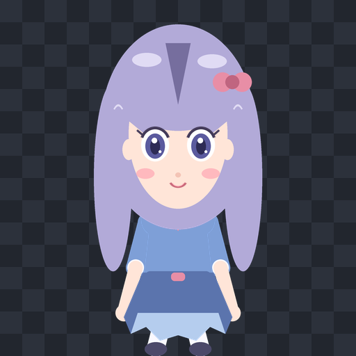

# 1-E 第二角色测试 + 性能/兼容性验收

> 日期：2026-10-23  
> 验收模式：Track A（生成符合契约的第二角色，不使用 `01.png` 做直接分割）  
> 结论：默认 `0.30` 缩放下通过；`0.76` / `1.0` 缩放功能兼容，但 CPU 高于 15% 目标（仍低于 20%）。

## 1. 测试环境

- Windows
- Python 3.12
- PyQt5 5.15.11 / Qt 5.15.2
- Pillow 13
- pywin32 312
- 屏幕：2560×1600，可用区域 2560×1528，设备像素比 1.0
- 默认显示缩放：`0.30`（`runtime/app.py` 的 `DEFAULT_DISPLAY_SCALE`）

## 2. 第二角色

- 路径：`assets/characters/demo2/`
- id：`demo2`
- 名称：小绘
- 风格：长发二次元角色（参考 `01.png` 的卡通二次元方向，但不是对 `01.png` 的分割）
- 9 个部件全部存在：
  - `head`、`body`
  - `arm_l`、`arm_r`
  - `leg_l`、`leg_r`
  - `eye_l`、`eye_r`
  - `mouth`
- 所有部件均为 `512×512` 全画布透明 PNG。
- 与 demo 使用不同的配色、比例、pivot 和待机台词。
- 契约校验：通过。



## 3. 动作复用

`demo2` 使用与 demo 完全相同的 8 个动作 JSON：

- `blink`
- `idle_breath`
- `jump`
- `nod`
- `shake_head`
- `walk`
- `wave`
- `yawn`

基准过程中 8/8 动作全部播放；动作键帧、缓动、循环和非循环逻辑未做角色特判。


## 4. 正式性能基准（默认 0.30，30 秒）

报告文件：`artifacts/1e_benchmark.json`

| 指标 | 实测 | 目标 | 结果 |
|---|---:|---:|---|
| 角色+动作加载时间 | 0.023s | ≤ 1.0s | 通过 |
| 平均 FPS | 61.73 | ≥ 55 | 通过 |
| p95 帧时间 | 18.68ms | ≤ 25ms | 通过 |
| 平均 CPU | 12.82% | ≤ 15% | 通过 |
| 峰值 CPU | 26.48% | 仅记录 | 菜单/交互测试造成瞬时峰值 |
| 工作集内存峰值 | 72.7MB | ≤ 250MB | 通过 |
| 内存增长 | +10.5MB | ≤ 20MB | 通过 |
| 动作覆盖 | 8/8 | 8/8 | 通过 |
| 待机台词 / 气泡 | 通过 | 通过 | 通过 |
| 拖拽 / 行走 / 右键菜单 | 通过 | 通过 | 通过 |

正式结果：**PASS**。

说明：`max_frame_ms` 为 307ms，出现在右键菜单测试的嵌套事件循环中；常规渲染 p95 为 18.68ms，p95 才是稳定渲染的指标。

## 5. 缩放兼容性

| 缩放 | 时长 | 平均 FPS | p95 帧时间 | 平均 CPU | 内存增长 | 8/8 动作 | 交互 | 结论 |
|---:|---:|---:|---:|---:|---:|---|---|---|
| 0.30 | 30s | 61.73 | 18.68ms | 12.82% | +10.5MB | 是 | 全通过 | 正式通过 |
| 0.76 | 18s | 61.23 | 19.52ms | 16.89% | +3.9MB | 是 | 全通过 | 兼容通过，CPU 高于 15% 目标 |
| 1.00 | 18s | 59.58 | 19.43ms | 18.97% | +3.8MB | 是 | 全通过 | 兼容通过，CPU 高于 15% 目标 |

结论：

- 默认 `0.30` 缩放达到全部正式验收阈值。
- `0.76` / `1.0` 的 FPS、帧时间、内存、动作和交互均正常；CPU 分别为 16.89% / 18.97%，高于 15% 目标但低于 20%。
- 更大显示比例需要绘制更大的窗口区域，CPU 上升是预期行为；后续可通过裁剪窗口或预缩放纹理继续优化。

## 6. 交互验收

- 右键菜单：能打开 `QMenu`；选择 `wave` 后动作变为 `wave`，选择“回到待机”后恢复 `idle_breath`。
- 左键拖拽：窗口位置发生变化，拖拽阈值 4px。
- 左键点击：触发待机台词 + 绑定动作 + 气泡。
- 中键行走：角色可见中心朝鼠标点击位置移动；已修正此前右下角偏移问题。
- 点击穿透：鼠标在角色上时 `WS_EX_TRANSPARENT=False`，移出角色后为 `True`。
- 点击穿透和中键行走使用 Qt 逻辑坐标，适配 Windows DPI 缩放。

## 7. 视觉验收

- `demo2` 预览：`assets/characters/demo2/preview.png`
- 动作复用图：`artifacts/1e_demo2_actions.png`
- 气泡短句：`artifacts/1d_bubble_small3_checker.png`
- 气泡长句：`artifacts/1d_bubble_long3_checker.png`
- 快速渲染与完整渲染对比：平均通道差异约 1.5，视觉一致。

## 8. 已知限制

- v1 没有独立 `hair` 部件；`demo2` 的长发烘焙在 `head.png` 内，头部旋转时头发会跟随头部移动。
- 手臂 `z=0` 在身体/头部之后；打哈欠时右手可能被头部遮住，这与当前契约的固定 z 顺序有关。
- 气泡绘制在同一个 `512×512` 窗口内；角色走到屏幕最上方时气泡可能超出可见区域。
- 本次正式基准为 30 秒短跑；10 分钟长时间内存稳定性尚未完整验证。可运行：
  ```bat
  .venv\Scripts\python.exe tools\benchmark_runtime.py --duration 600 --output artifacts\1e_benchmark_600s.json
  ```
- 本机 DPI 比例为 1.0；125%/150% DPI 需要在目标机器上再验证。

## 9. 结论

1-E 的正式验收在默认 `0.30` 缩放、30 秒基准下通过：

- 第二角色 `demo2` 符合契约；
- 8 个共享动作全部可复用；
- 待机台词、气泡、拖拽、点击、行走、右键菜单和点击穿透均可用；
- 默认缩放下 FPS、帧时间、CPU、内存和加载时间达到目标。

下一步进入 **第 2 步：照片 → 卡通 → 半自动分层**。